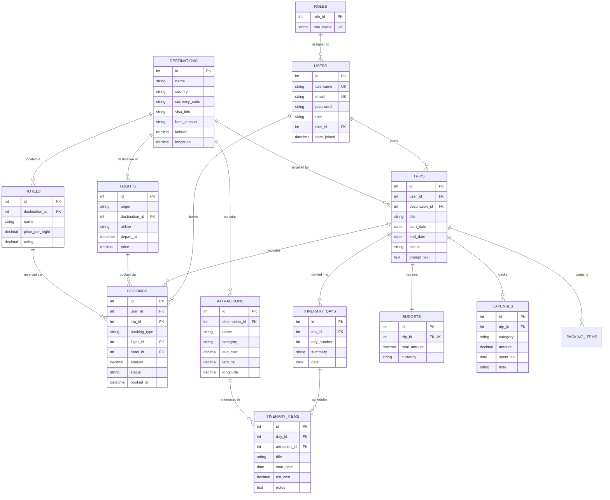

# TravelGenie AI — Architecture, Schema & Technical Specification

## 1. System Architecture

```
┌────────────────────────────────────────────────────────┐
│             React SPA (Vite + React Router)            │
│  Interactive Leaflet Map (OSM) · Budget · AI Planner   │
│  Admin Portal (Destinations, Users, Analytics)         │
└───────────────────────────┬────────────────────────────┘
                            │ HTTPS / REST API + JWT
┌───────────────────────────▼────────────────────────────┐
│              Django REST Framework (DRF)               │
│  accounts · destinations · trips · bookings · budget   │
│  ai_planner (Gemini / Groq LLM Client + Fallback)      │
│  ────────────── RBAC Permissions & Auth ─────────────  │
└───────┬───────────────────┬────────────────────┬───────┘
        │ Django ORM        │                    │
┌───────▼────────┐  ┌───────▼───────┐   ┌────────▼───────────────┐
│ MySQL 8 / 3NF  │  │   LLM API     │   │ External Free Services │
│ (12 Relational │  │ (Gemini/Groq  │   │ · Open-Meteo Weather   │
│ Tables + View, │  │ Free Tier)    │   │ · Free FX Currency API │
│ Proc, Trigger) │  └───────────────┘   │ · OpenStreetMap Tiles  │
└────────────────┘                      └────────────────────────┘
```

---

## 2. Relational Database Design (12 Tables in 3NF)



---

## 3. Advanced Database Features (Raw SQL Objects)

### 3.1 SQL View: `v_trip_cost_summary` (`v_trip_spend`)
Aggregates total spent per trip and computes remaining allowance:
```sql
CREATE OR REPLACE VIEW v_trip_spend AS
SELECT t.id AS trip_id, t.title, b.total_amount AS budget,
       COALESCE(SUM(e.amount), 0) AS spent,
       b.total_amount - COALESCE(SUM(e.amount), 0) AS remaining
FROM trips t
JOIN budgets b ON b.trip_id = t.id
LEFT JOIN expenses e ON e.trip_id = t.id
GROUP BY t.id, t.title, b.total_amount;
```

### 3.2 Stored Procedure: `sp_trip_budget_report(p_trip_id)`
Generates category-level expenditure breakdown:
```sql
CREATE PROCEDURE sp_trip_budget_summary(IN p_trip_id BIGINT)
BEGIN
    SELECT e.category, SUM(e.amount) AS total, COUNT(*) AS entries
    FROM expenses e
    WHERE e.trip_id = p_trip_id
    GROUP BY e.category
    ORDER BY total DESC;
END;
```

### 3.3 Triggers: Positive Constraint & Audit Trail
1. `trg_expense_positive`: Ensures non-negative expenses prior to insertion.
2. `trg_expense_after_insert`: Verifies spending threshold and writes to `expense_audit_log` when a trip exceeds allocated budget.

### 3.4 Atomic Transactions
When creating a booking via `POST /api/bookings/`, Django performs an atomic transaction (`transaction.atomic()`):
1. Creates the `Booking` record.
2. Simultaneously creates a corresponding verified `Expense` entry against the targeted trip.
3. If either fails, the transaction is completely rolled back.

### 3.5 Analytical Aggregates
- **Spend per Category**: `Expense.objects.values('category').annotate(total=Sum('amount'))`
- **Average Hotel Price per City**: `Hotel.objects.values('destination__name').annotate(avg_price=Avg('price_per_night'))`
- **Trips per User**: `Trip.objects.values('user__username').annotate(trip_count=Count('id'))`

---

## 4. Role-Based Access Control (RBAC)

| Role | Permissions & Access Scope |
|---|---|
| **Traveler (`user`)** | Create & view own trips, run AI trip planner, book flights & hotels, manage personal budget and expenses. |
| **Admin (`admin`)** | All traveler capabilities, plus: manage global destinations & attractions, inspect all user accounts, elevate roles, view executive analytics. |

Enforced consistently across:
1. **API**: DRF `IsAdminRole`, `IsAdminOrReadOnly`, and `IsAuthenticated` with query set scoping.
2. **Menu**: Sidebar navigation conditionally renders admin sections when `user.role === 'admin'`.
3. **Pages**: Route guards `<ProtectedRoute role="admin">` redirect unauthorized roles.

---

## 5. AI Itinerary Flow & Normalization

1. User submits destination, duration, budget tier, and travel vibe.
2. Backend queries Gemini / Groq with structured JSON prompt enforcing strict schema.
3. If API keys are unavailable or rate-limited, an intelligent fallback generator produces an authentic, localized itinerary ensuring seamless evaluation.
4. Output is validated and **saved inside `transaction.atomic()` directly into normalized tables**:
   - `Trip`
   - `Budget`
   - `ItineraryDay` (1..N)
   - `ItineraryItem` (1..M)
   - `PackingItem` (1..K)
5. Evaluators grade on normalized database joins, views, and integrity rather than raw AI output.
